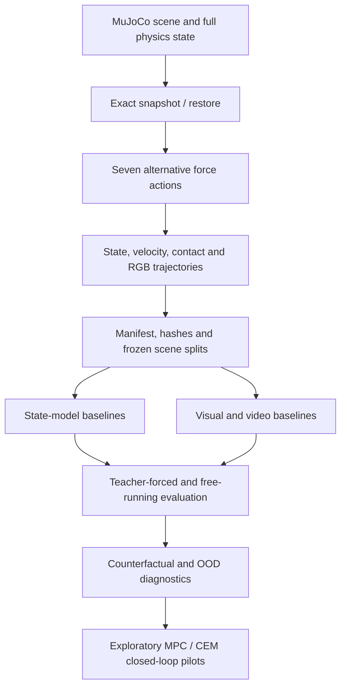

# WorldDynamics

**Reliable Action-Conditioned World Models for Long-Horizon Physical Prediction**

[](https://github.com/Benjamindaoson/WorldDynamics/actions/workflows/tests.yml)
[](https://www.python.org/)
[](https://mujoco.org/)

WorldDynamics is a research codebase for studying whether learned predictive models can distinguish the physical futures caused by **different actions applied to the same initial state**. The project focuses on action fidelity, long-horizon rollout stability, counterfactual prediction, and the usefulness of learned dynamics for closed-loop decisions.

> **Central research question:** Can a world model predict not only what is likely to happen next, but how the future changes when an agent chooses a different action from the same physical state?

**Research status:** Reproducible small-scale MuJoCo baselines and negative findings are available. The current experiments do **not** establish a novel algorithm, a general advantage for action conditioning, state-of-the-art performance, or transfer to a physical robot.

<details>
<summary>中文概要</summary>

WorldDynamics 研究动作条件世界模型能否在相同物理初态下，准确区分不同动作产生的未来。项目包含 MuJoCo 同状态多动作分支数据生成、状态动力学模型、RSSM、轻量级视频预测、World-Action 联合基线，以及 MPC/CEM 闭环评估。

当前最重要的实验结论是：在已完成的 V2 独立确认实验中，动作条件模型没有优于 action-blind 基线。项目保留了这一负面结果，不将工程实现、单元测试或小规模仿真包装成已验证的算法创新或真机成果。

</details>

## Contents

- [Research scope](#research-scope)
- [Experimental pipeline](#experimental-pipeline)
- [Environment and dataset](#environment-and-dataset)
- [Models and baselines](#models-and-baselines)
- [Experimental results](#experimental-results)
- [LeWorldModel integration audit](#leworldmodel-lewm-integration-audit)
- [Installation](#installation)
- [Reproduce the V2 state-model experiments](#reproduce-the-v2-state-model-experiments)
- [Evaluation protocol](#evaluation-protocol)
- [Repository structure](#repository-structure)
- [Reproducibility and artifact policy](#reproducibility-and-artifact-policy)
- [Limitations and non-claims](#limitations-and-non-claims)
- [Research directions](#research-directions)
- [License and citation](#license-and-citation)

---

## Research scope

A conventional next-state predictor can achieve low prediction error while ignoring the action, especially when the environment contains slowly moving objects or weak action effects. Such a model may reconstruct plausible trajectories but still fail to answer the decision-relevant question:

**What would happen if a different action were applied from exactly the same physical state?**

WorldDynamics treats this as an empirical question rather than assuming that action conditioning or paired supervision is beneficial.

The project investigates four connected capabilities:

1. **Interventional data generation** — restore an identical simulator state and execute alternative actions from that state.
2. **Action-conditioned dynamics** — compare action-blind, action-conditioned, paired-difference, shuffled-pair, and recurrent latent-state baselines.
3. **Long-horizon prediction** — separate one-step accuracy, teacher-forced prediction, free-running rollout, and counterfactual branch fidelity.
4. **Decision utility** — test whether model predictions improve realized outcomes in a closed-loop simulator task.

The current physical task is a freely moving cube on a plane. It is a controlled dynamics benchmark for this repository, **not** a robotic manipulation benchmark.

## Experimental pipeline

The diagram describes the implemented research workflow. It is not a claim that all branches form one deployed or production-ready system.



The main information boundary is explicit:

- A learned predictor receives the current observation and candidate action sequence.
- During free-running evaluation, it does not receive future simulator states.
- The privileged physics Oracle is reported separately and is never presented as a learned model.
- Physical state is used for data generation, supervision, and offline scoring; future ground truth is not an input to learned action selection.

## Environment and dataset

### MuJoCo cube task

The V2 dataset uses exact simulator snapshot/restore to create paired action branches. Each branch starts from the same initial physical state within its scene.

| Property | V2 setting |
|---|---|
| Simulator | MuJoCo |
| Task | Freely moving cube on a plane |
| Action | 3D force vector, measured in newtons |
| State | 3D position; velocity-aware models also receive 3D velocity |
| Visual observation | 32 × 32 RGB |
| Action branches | 7 per scene |
| Prediction horizon | 64 action steps |
| Observed states / frames | 65 per branch |
| Total scenes | 72 |
| Total action branches | 504 |

### Frozen data split

| Evaluation family | Scenes | Purpose |
|---|---:|---|
| Train | 32 | Model fitting |
| IID validation | 8 | Validation during training |
| IID test | 8 | Held-out in-distribution evaluation |
| Physics OOD | 8 | Held-out physical parameter configurations |
| Geometry OOD | 8 | Held-out cube geometry configurations |
| Independent confirmation | 8 | One-time confirmatory evaluation |
| **Total** | **72** | |

The seven action branches are generated from exact restored states. The data manifest records source revision, simulator version, scene and physics metadata, branch actions, initial-state information, and artifact hashes. Validation checks branch-start consistency, hashes, and split integrity.

The frozen V2 dataset manifest SHA-256 is:

```text
8c7815f8015ce075d20d6b44f4caecd875e6e1b3cd73e4a75c8802a0aa6730ea
```

The dataset was generated from source revision `3f97ef9351443adce84613d77a3c8e508cbdf626`. Raw data are not stored in the public Git repository; see [Reproducibility and artifact policy](#reproducibility-and-artifact-policy).

## Models and baselines

### State-dynamics models

| Model family | Purpose |
|---|---|
| Identity / constant initial velocity | Simple non-learned reference baselines |
| Action-blind predictor | Tests whether the model can perform well without using actions |
| Action-conditioned predictor | Tests direct action-conditioned residual prediction |
| Paired-difference supervision | Tests whether paired branch differences improve action response |
| Shuffled-pair control | Tests whether any apparent benefit depends on correct action/branch pairing |
| RSSM | Recurrent state-space model with a prior/posterior information boundary |

The RSSM predicts from its prior before incorporating the next observation. In free-running mode, it rolls forward using prior states rather than future observation-conditioned posteriors. A prior future-observation leakage issue in an earlier implementation was corrected and covered by regression tests.

### Visual and video baselines

| Model | Scope | Evidence status |
|---|---|---|
| VisualPredictor | Small visual representation and action-conditioned latent prediction baseline | Implemented exploratory baseline |
| VideoFlow | Compact latent flow-matching video predictor with a deterministic frame codec | Single-seed, low-resolution experiment |
| JointWorldAction | Shared visual representation with world-prediction and inverse-action heads | Single-seed exploratory experiment |

These are small models trained from scratch on the repository's MuJoCo data. **VideoFlow is not a Video VAE or a large Video DiT. VisualPredictor is not V-JEPA 2-AC. JointWorldAction is not a validated WAM contribution.**

### Closed-loop planning

The planning pilots compare random control, a privileged greedy physics Oracle, learned-model MPC, and learned-model CEM. The learned planners rank candidate actions using current observations and frozen model predictions. Only the Oracle evaluates candidate actions directly in restored simulator states.

## Experimental results

The results below are deliberately reported with their limitations. Negative findings are part of the research record.

### V2 primary confirmatory result

The confirmatory protocol was frozen before V2 data generation. All 24 predeclared learned state-model runs were completed before the independent confirmation labels were used. The primary comparison uses the final-step counterfactual-delta MSE for the velocity-aware action-blind and action-conditioned models.

| Quantity | Result |
|---|---:|
| Primary statistic | Action-blind error − action-conditioned error |
| Observed difference | **−5.40476 m²** |
| Scene-bootstrap 95% interval | **[−6.86249, −3.92626] m²** |
| Confirmation scenes | 8 |
| Training seeds per learned arm | 17, 29, 43 |
| Scene-level differences | All 8 negative |

A positive primary statistic would favor action conditioning. The observed value is negative, and all eight scene-level differences are negative. Therefore, **the V2 primary experiment does not support the hypothesis that the action-conditioned baseline improves counterfactual prediction over the action-blind baseline**.

| Confirmatory model | Free-running xyz MSE (m²) | Counterfactual-delta MSE (m²) |
|---|---:|---:|
| Identity | 0.00831 | 0.02725 |
| Blind position | 0.01578 | 0.02725 |
| Conditioned position | 0.03463 | 0.18416 |
| Paired position | 0.03365 | 0.17465 |
| Blind position + velocity | 1.75757 | 0.02725 |
| Conditioned position + velocity | 0.75703 | 5.43201 |
| RSSM position + velocity | 0.00916 | 0.01244 |

The confirmation set contains only eight scenes. Its bootstrap interval describes variability within this small protocol; it is not evidence of generalization to arbitrary physical systems.

### V2 long-horizon state prediction

The table reports mean free-running xyz MSE at exactly 64 steps on the IID test family, averaged over seeds 17, 29, and 43.

| Model | H64 free-running MSE (m²) |
|---|---:|
| Blind position | 0.10534 |
| Conditioned position | 0.15611 |
| Blind position + velocity | 20.09177 |
| Conditioned position + velocity | 5.15384 |
| RSSM position + velocity | 0.03175 |

The RSSM has lower long-horizon error in this pilot, but its H1 error is comparatively high (0.01049 m²). Its flatter long-horizon curve may partly reflect convergence toward a stable mean. Lower rollout MSE alone does not establish that a model has learned action-sensitive physical dynamics.

### Historical V1.1 state-model result

The earlier V1.1 experiment used 32 scenes, seven branches per scene, and a 32-step horizon. Its mean free-running MSE was:

| Model | Free-running MSE (m²) |
|---|---:|
| Action-blind | 0.000199 |
| Action-conditioned | 0.002660 |
| Conditioned + paired differences | 0.002076 |

This earlier exploratory result also favored the action-blind baseline. It is a separate dataset and protocol from V2 and should not be pooled with V2 metrics.

### Video and joint world-action experiments

The V2 VideoFlow experiment used one seed, 32 × 32 RGB, and a compact model. On IID test, paired-noise free-generation PSNR was 12.36 dB for the conditioned model and 12.02 dB for the blind model, while SSIM was 0.4084 and 0.4533 respectively. The conditioned model's predicted visual branch effect was over 100 times the measured mean branch pixel effect. PSNR alone therefore gives a misleading impression of action fidelity. LPIPS, FVD, and video-derived physical-state error are not available.

The single-seed JointWorldAction experiment did not show a joint-training benefit. On IID test, decoded next-frame MSE was 0.000334 for world-only training and 0.002254 for joint training; inverse-action MAE was 2.4301 N for action-only and 2.4770 N for joint training. These are exploratory teacher-forced measurements, not multi-seed or long-horizon evidence.

### Closed-loop planning pilot

| Policy | Successes per seed on 8 scenes |
|---|---|
| Random | 0 / 8, 0 / 8, 0 / 8 |
| Greedy physics Oracle | 5 / 8, 5 / 8, 5 / 8 |
| Conditioned-model MPC | 1 / 8, 0 / 8, 0 / 8 |
| Conditioned-model CEM | 1 / 8, 0 / 8, 0 / 8 |

The greedy Oracle itself reaches only five of the eight scenes. The task therefore has unresolved feasibility limitations, and the learned planners do not support a learned-control success claim. The reported regret is relative to the greedy reference, not globally optimal control.

### Detailed reports

- [V2 state-model baseline and independent confirmation](docs/V2_BASELINE_REPORT.md)
- [V2 64-step rollout analysis](docs/V2_LONG_HORIZON_REPORT.md)
- [V2 video-flow baseline](docs/V2_VIDEO_REPORT.md)
- [V2 joint world-action baseline](docs/V2_WAM_REPORT.md)
- [V2 closed-loop planning pilot](docs/V2_PLANNING_REPORT.md)
- [V1.1 baseline results](docs/V11_BASELINE_RESULTS.md)
- [V1.1 long-horizon and video report](docs/V11_LONG_HORIZON_REPORT.md)
- [Action-causality diagnosis](docs/ACTION_CAUSALITY_REPORT.md)

## LeWorldModel (LeWM) integration audit

The repository also contains a separate, evidence-gated preflight track for the upstream [LeWorldModel repository](https://github.com/lucas-maes/le-wm), pinned to commit:

```text
8edfeb336732b5f3ce7b8b210d0ba370a09e2cac
```

No upstream LeWorldModel model source is copied into this repository.

The recorded G0 audit established two limited facts:

- A synthetic fixture passed the `stable-worldmodel` Loader contract.
- A bounded remote Lance probe read two scalar rows and one 224 × 224 RGB image from a pinned public candidate dataset revision.

These checks do **not** establish full official dataset loading through the LeWM Loader, equivalence to the published HDF5 dataset, GPU training, checkpoint production, or independent model evaluation. The recorded status is `BOUNDED_LANCE_READ_VERIFIED_GPU_BLOCKED`.

Relevant materials:

- [G0 baseline audit](docs/V2_BASELINE_AUDIT.md)
- [G0 research contract](docs/V2_RESEARCH_CONTRACT.md)
- [G0 implementation plan](docs/V2_IMPLEMENTATION_PLAN.md)
- [LeWM runbook](docs/G0_LEWM_RUNBOOK.md)
- [G0 preflight report](reports/G0_PRECHECK_2026-10-15.md)
- [Pinned source and dataset record](configs/lewm/g0_source_lock.json)
- [OpenSpec change](openspec/changes/world-model-v2-g0/proposal.md)

## Installation

### Requirements

- Python 3.10 or newer
- PyTorch 2.3 or newer
- MuJoCo 3.x
- NumPy
- PyYAML
- Optional visualization dependencies: Matplotlib and Pillow

The documented V2 experiments were run with Python 3.12, CPU-only PyTorch, and MuJoCo. The current GitHub Actions workflow tests on Python 3.11 with CPU PyTorch and headless MuJoCo rendering.

### Create an environment

Linux / macOS:

```bash
python -m venv .venv
source .venv/bin/activate
python -m pip install --upgrade pip
python -m pip install -e ".[test,research,visualization]"
```

Windows PowerShell:

```powershell
py -3.12 -m venv .venv
.\.venv\Scripts\Activate.ps1
python -m pip install --upgrade pip
python -m pip install -e ".[test,research,visualization]"
```

For a CPU-only PyTorch environment, install the CPU wheel using the official PyTorch index before installing the project extras:

```bash
python -m pip install --index-url https://download.pytorch.org/whl/cpu "torch>=2.3"
python -m pip install -e ".[test,research,visualization]"
```

For CUDA, install a PyTorch build matching the target CUDA runtime and GPU using the [official PyTorch installation selector](https://pytorch.org/get-started/locally/). GPU training and scaling are not established by the current public experiments.

## Reproduce the V2 state-model experiments

All commands below create new output directories. Do not reuse an existing output directory.

### 1. Generate and validate the dataset

```bash
python scripts/generate_v2_data.py \
  --output artifacts/v2-data \
  --train-scenes 32 \
  --eval-scenes 8 \
  --horizon 64

python scripts/validate_data.py artifacts/v2-data
```

### 2. Train the predeclared model matrix

```bash
python scripts/run_v2_baselines.py \
  --dataset artifacts/v2-data \
  --output artifacts/v2-baselines \
  --seeds 17 29 43 \
  --epochs 10
```

This trains eight arms: blind, conditioned, paired, and shuffled-pair variants, plus RSSM, with position-only and velocity-aware configurations as defined in the script. The training script uses IID validation data for validation; it does not use confirmation labels.

### 3. Run exploratory IID and OOD evaluation

```bash
python scripts/evaluate_v2_matrix.py \
  --dataset artifacts/v2-data \
  --runs artifacts/v2-baselines \
  --output results/v2-exploratory \
  --families iid_test physics_ood geometry_ood
```

The evaluator writes per-run metrics, per-scene counterfactual diagnostics, and a `matrix.json` summary.

### 4. Confirmatory evaluation

The independent confirmation family must be evaluated **once only after** model choices, metrics, and analysis decisions are frozen. The original V2 confirmation has already been run and reported. Do not rerun it and treat a second result as an independent confirmation. Any changed model, metric, data-generation rule, or analysis protocol requires a newly versioned protocol and a new untouched confirmation family.

See [CONFIRMATORY_PROTOCOL.md](docs/CONFIRMATORY_PROTOCOL.md) before conducting a new confirmatory experiment.

## Evaluation protocol

| Evaluation | What it measures | Key restriction |
|---|---|---|
| Teacher-forced prediction | Next-state accuracy with real history | Future target is not supplied before its prediction |
| Free-running rollout | Stability when predictions feed subsequent steps | Only the initial state and action sequence are provided |
| Counterfactual branch error | Whether different actions produce correctly differentiated futures | Compare branches from the same restored simulator state |
| Physics OOD | Generalization to held-out mass/friction settings | Do not tune on OOD labels |
| Geometry OOD | Generalization to held-out cube sizes | Keep scene families disjoint |
| Closed-loop planning | Realized task outcome after selected actions | Learned planner cannot query future simulator states |
| Video metrics | Pixel-level reconstruction and prediction | Pixel metrics do not establish physical or action consistency |

The confirmatory protocol defines the primary metric, seeds, model arms, evaluation order, and bootstrap procedure. The independent confirmation family is not a development set.

## Repository structure

```text
WorldDynamics/
├── configs/
│   ├── models/                  # State, RSSM, video and WAM configs
│   └── lewm/                    # Pinned upstream/data audit records
├── docs/
│   ├── V2_BASELINE_REPORT.md
│   ├── V2_LONG_HORIZON_REPORT.md
│   ├── V2_VIDEO_REPORT.md
│   ├── V2_WAM_REPORT.md
│   ├── V2_PLANNING_REPORT.md
│   ├── CONFIRMATORY_PROTOCOL.md
│   ├── V2_RESEARCH_CONTRACT.md
│   └── ...                      # Audits, runbooks and research notes
├── openspec/                    # G0 requirements and design records
├── reports/                     # G0 preflight and audit receipts
├── scripts/
│   ├── generate_v2_data.py
│   ├── run_v2_baselines.py
│   ├── evaluate_v2_matrix.py
│   ├── evaluate_v2_planning.py
│   ├── train_v2_wam.py
│   └── ...                      # Data, video, evaluation and audit tools
├── src/iwm/
│   ├── paired_replay.py         # Same-state branch replay contracts
│   ├── mujoco_paired_backend.py # MuJoCo physical replay backend
│   ├── data.py                  # Dataset manifests and validation
│   ├── v2_data.py               # V2 scene and branch generation
│   ├── models.py                # ActionPredictor and RSSM
│   ├── training.py              # State-model training/checkpoints
│   ├── evaluation.py            # Rollout and state metrics
│   ├── visual_models.py         # Visual, VideoFlow and JointWorldAction
│   ├── causality.py              # Counterfactual/action diagnostics
│   ├── geometry.py              # Differentiable geometry utilities
│   └── g0_preflight.py          # Read-only LeWM G0 preflight
└── tests/                       # Unit and regression tests
```

## Reproducibility and artifact policy

The repository keeps source code, configuration, protocols, tests, and concise evidence reports under version control.

The following are generated locally and are intentionally excluded from Git:

- MuJoCo datasets and RGB trajectories
- Model checkpoints and optimizer states
- Full per-scene and per-frame evaluation outputs
- Generated videos, GIFs, and plots
- Virtual environments, caches, and temporary run directories

To reproduce a result, record at least:

- Git commit SHA and dataset manifest SHA-256
- MuJoCo Python and engine versions
- Scene split, physical parameters, and action sequence
- Model configuration, seed, and training budget
- Checkpoint and evaluation artifact hashes
- Exact metric definition, denominator, and aggregation unit
- Runtime, device, and relevant software versions

The public reports summarize local experiment evidence, but they do not contain all raw trajectories or checkpoints. External researchers should regenerate the dataset using the frozen generator and protocol before attempting replication.

## Limitations and non-claims

The current repository does **not** claim:

- A novel world-model algorithm or a demonstrated literature-level research gap
- State-of-the-art performance on a public benchmark
- Reliable action-conditioned prediction across general physical systems
- Successful learned closed-loop control
- Real-robot or sim-to-real validation
- An official V-JEPA 2 or V-JEPA 2-AC reproduction
- A trained large-scale Video DiT or production-grade video world model
- Full LeWorldModel training or checkpoint reproduction
- CUDA training, multi-GPU scaling, or large-model throughput results

The current task is a small MuJoCo cube environment. The models are compact baselines, and the negative findings should be treated as evidence that motivates better experiments—not as proof that action-conditioned world models cannot work.

## Research directions

The next experiments should address the observed failure modes before making stronger claims:

1. **Action sensitivity:** improve state/action observability and test whether models learn the correct direction and magnitude of physical response.
2. **Dynamics coverage:** add controlled initial velocities, contact regimes, geometry variation, and feasibility-qualified planning scenes.
3. **Matched comparisons:** control data, parameter count, optimization steps, and compute when comparing action-blind, conditioned, paired, and recurrent models.
4. **Uncertainty and physical consistency:** evaluate calibrated uncertainty, contact-event timing, counterfactual consistency, and failure detection.
5. **Planning utility:** test whether prediction improvements translate into realized closed-loop gains under fixed planning budgets.
6. **Visual world models:** improve action fidelity and object-level physical metrics before interpreting pixel-level video scores.
7. **Robot transfer:** move to a separate manipulation simulator only after the cube-task baselines and evaluation contracts are reliable; real-robot experiments require their own safety and validation protocol.

The project follows an evidence-gated progression: implementation → tests → actual training → independent evaluation → audit → publication-quality claims.

## License and citation

**No repository-wide license file is currently provided.** Reuse and redistribution rights for this repository should not be assumed. The MIT license recorded for the upstream LeWorldModel project applies to that upstream project; it does not automatically license WorldDynamics.

No peer-reviewed paper is associated with this repository at this time. If referencing this work, cite the repository URL and the exact commit used:

```text
https://github.com/Benjamindaoson/WorldDynamics
```

---

**Repository:** [github.com/Benjamindaoson/WorldDynamics](https://github.com/Benjamindaoson/WorldDynamics)  
**Default branch:** `main`  
**Primary package:** `iwm`
